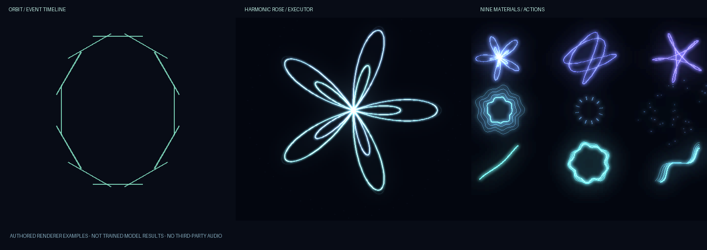
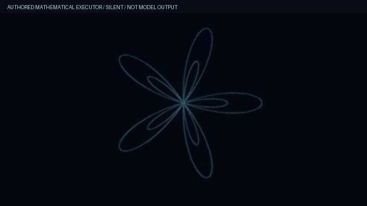
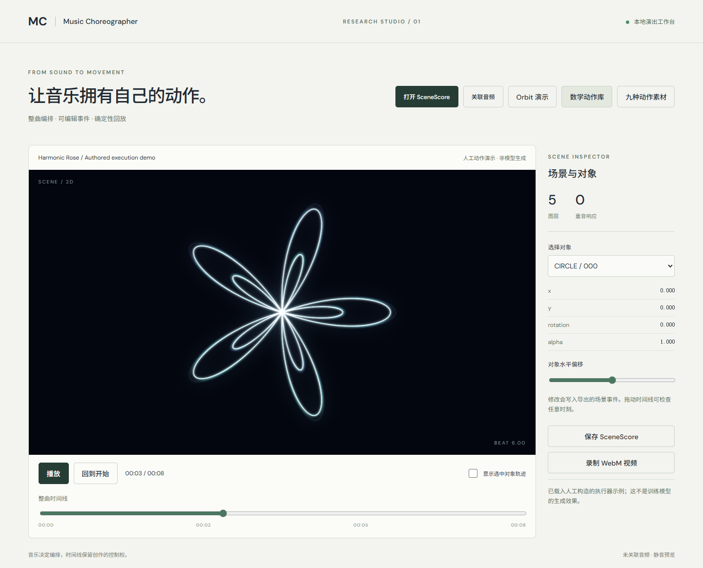
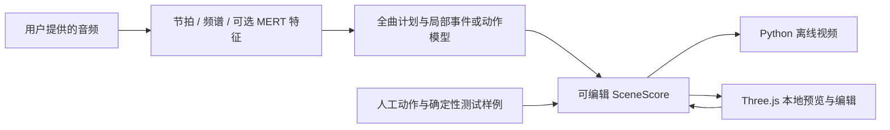

# Pigurous · Music Choreographer

把音频转换成可编辑的几何演出时间线，再由 Python 离线渲染器和 TypeScript / Three.js 播放器确定性回放。

这是一个研究代码发布：包含事件协议、谱面转换、音乐特征、训练与生成入口、动作执行器，以及本地编辑预览器。Python 包名沿用 `music-choreographer`，命令为 `choreo`。



**上图及下方动图均为手工构造的执行器示例，不是训练模型的生成结果。** 它们只展示事件回放与几何动作，不含下载的音乐或谱面。



## 先体验预览器

需要 Node.js 20+。这一部分不需要 GPU、API 密钥、训练数据或权重。

```bash
git clone https://github.com/EugneLNC/pigurous.git
cd pigurous/preview
npm ci
npm run dev
```

打开终端给出的本地地址，通常是 `http://127.0.0.1:5173`。内置 Orbit、数学动作库和九种动作素材都是人工示例。可以播放、暂停、拖动时间线、查看对象轨迹、调整水平偏移，再保存 SceneScore。关联自己的音频后，可进行本地音画预览与 WebM 录制。



## 系统如何工作



SceneScore 保存时间、实体、属性变化和来源信息。事件、动作参数与渲染执行分开；保存后的场景可以重复播放和定位，不必重新调用模型。人工数学曲线与图元执行逻辑不会被当作新的学习能力。

## Python 核心

需要 Python 3.10+；视频导出还需要可执行的 FFmpeg。

```bash
python -m venv .venv
# 激活虚拟环境后：
python -m pip install -e ".[test]"
python -m pytest -q
python scripts/make_public_demo.py
choreo render preview/public/demo.json -o artifacts/orbit.mp4 --width 1280 --height 720 --fps 30
```

项目固定使用 PyTorch 2.7.0；需要 CUDA 时，请先按对应平台安装该版本。`audio` 可选依赖中的 `torchaudio` 同样固定为 2.7.0。生成上方图片和动图只用人工场景，不会发起网络模型请求。

真实音频研究的入口包括 `convert`、`prepare`、`train`、`analyze`、`plan`、`generate`、`render` 和 `evaluate`。数据准备与各代实验记录见 [历史研究说明](docs/HISTORICAL_README.md)、[验证记录](docs/VALIDATION.md) 和 [v3 动作实验](docs/LLM_CHOREOGRAPHY.md)。历史文档中的 `data/`、`runs/`、`artifacts/` 路径属于单独的实验资产，不是本仓库随附内容。

LLM 全曲规划是可选模块。当前保留的 Windows 凭据桥从本机用户配置读取密钥；仓库不包含凭据。未配置凭据时，请使用人工示例或自己的 SceneScore，不必运行 `plan`。运行在线规划可能产生服务费用，演示与测试不会自动调用它。

## 目录与验证

| 路径 | 内容 |
|---|---|
| `src/choreographer/` | SceneScore、导入、音频特征、模型、训练、生成与渲染 |
| `preview/` | Three.js 播放、定位、编辑及导出；仅捆绑人工场景 |
| `configs/`、`schemas/` | 研究配置与数据协议 |
| `scripts/` | 样例生成、数据准备和研究工具 |
| `tests/` | 时间、曲线、生命周期、模型及 Python/TS 一致性测试 |
| `docs/` | 研究记录、边界、可复现图片与动图 |

```bash
python -m pytest -q
cd preview
npm test
npm run build
```

本次发布验证：**Python 42 项通过、前端 7 项通过、生产构建与 Edge 交互检查通过**，详见 [发布验证](docs/RELEASE_VALIDATION.md)。

`compare.html` 和 `review.html` 保留为研究工具源码，需要自行准备比较清单和反馈数据；默认演示首页不会加载私有研究资产。

## 当前结果的边界

历史实验完成过真实训练和生成，也记录了失败项：审美盲评尚未完成，动作的空间编排未通过平均运动基线比较，偏好训练没有改善独立验证集。音频消融敏感性不能单独证明有益的音乐对齐。详见原始验证记录，不将工程可运行等同于生成质量已通过验收。

公开发布保留核心代码与测试，排除数十 GiB 的下载数据、特征张量、训练缓存、重复打包产物和机器凭据。精选权重、人工偏好标注与来源清单保留在原研究资产中，没有混入本次代码包。

## 许可与来源

项目代码使用 [MIT License](LICENSE)。依赖、原始音乐、谱面和预训练权重分别遵循各自条款；公开可下载不等于获准再分发或商业训练。仓库示例由本项目脚本构造，不捆绑第三方音频、谱面或 MERT 权重。参见 [来源说明](THIRD_PARTY_NOTICES.md)。
